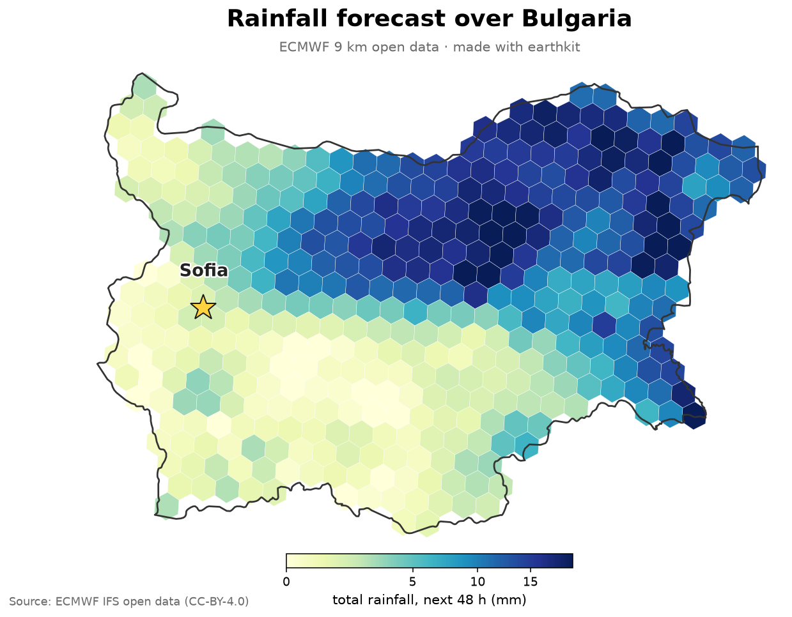
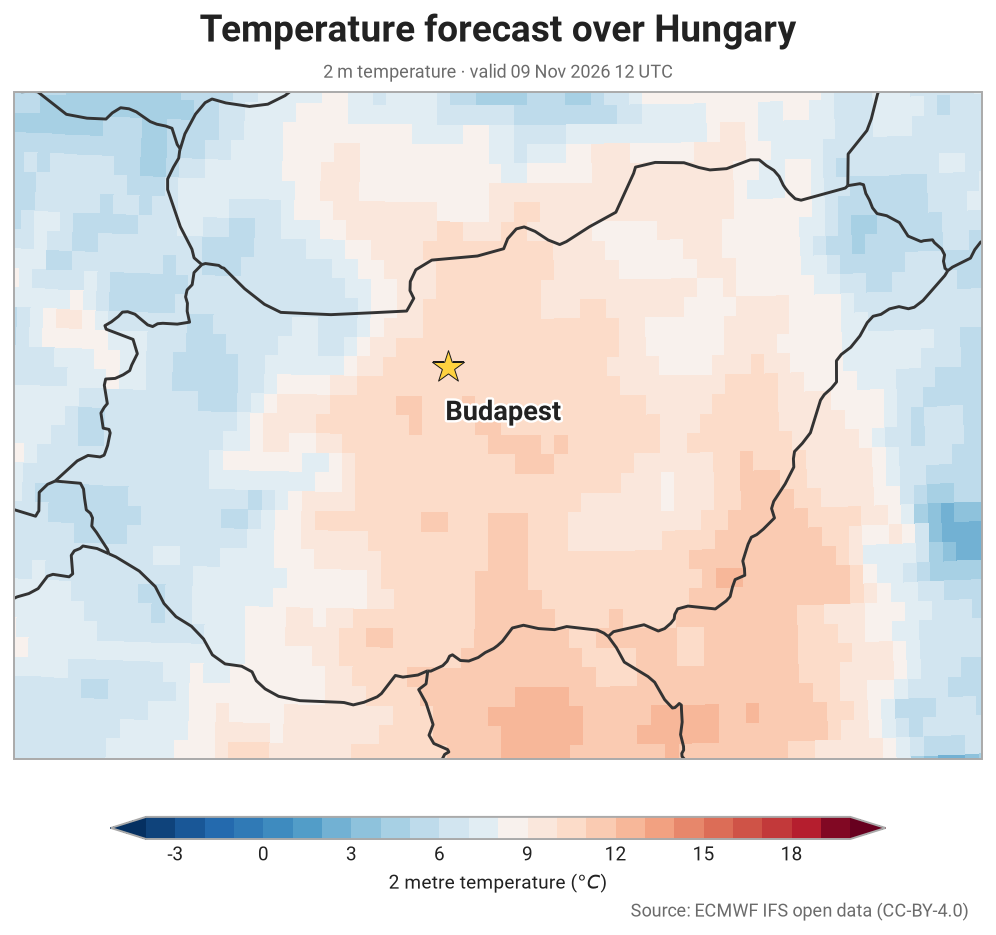
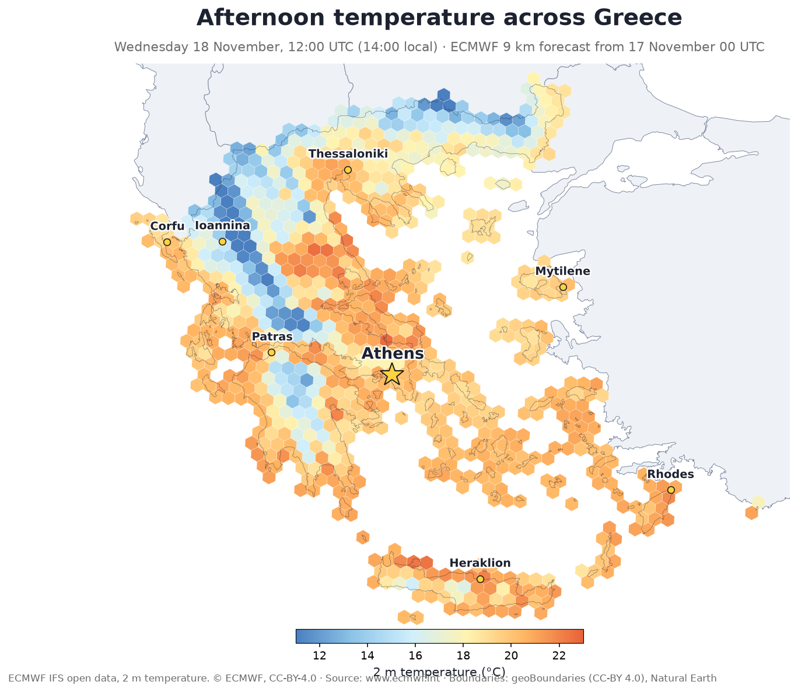
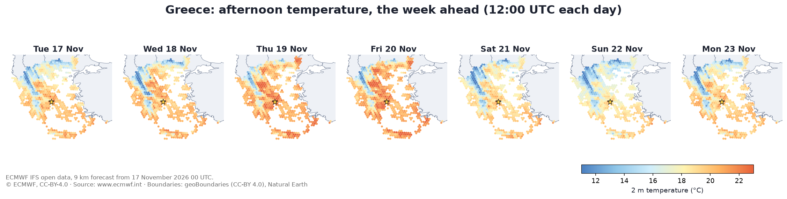
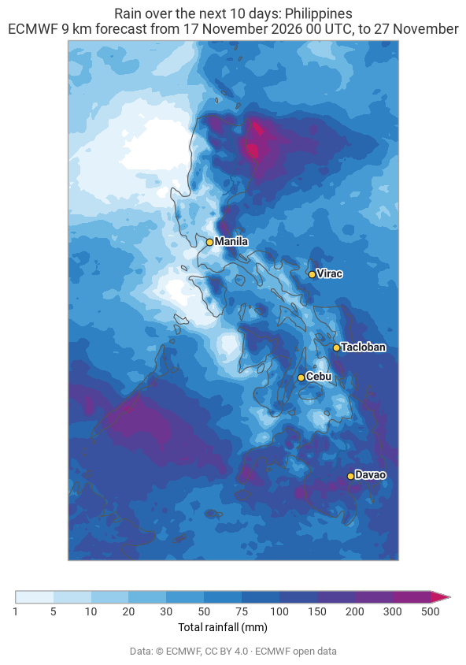
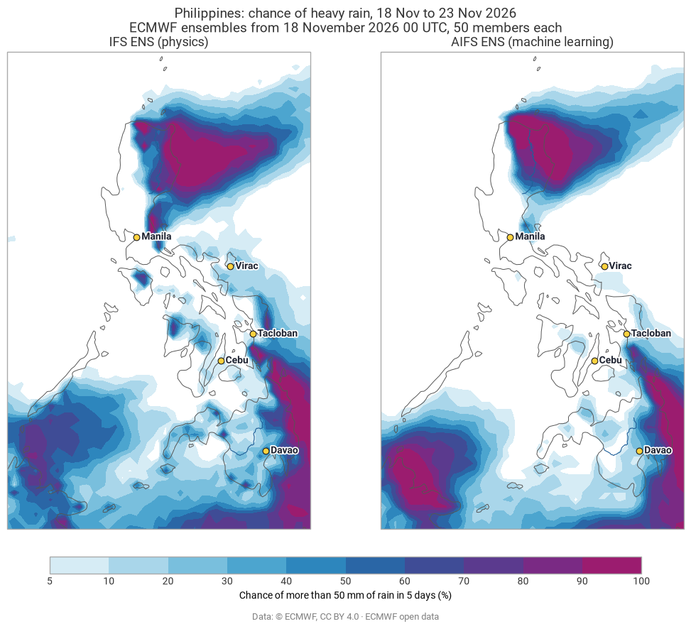
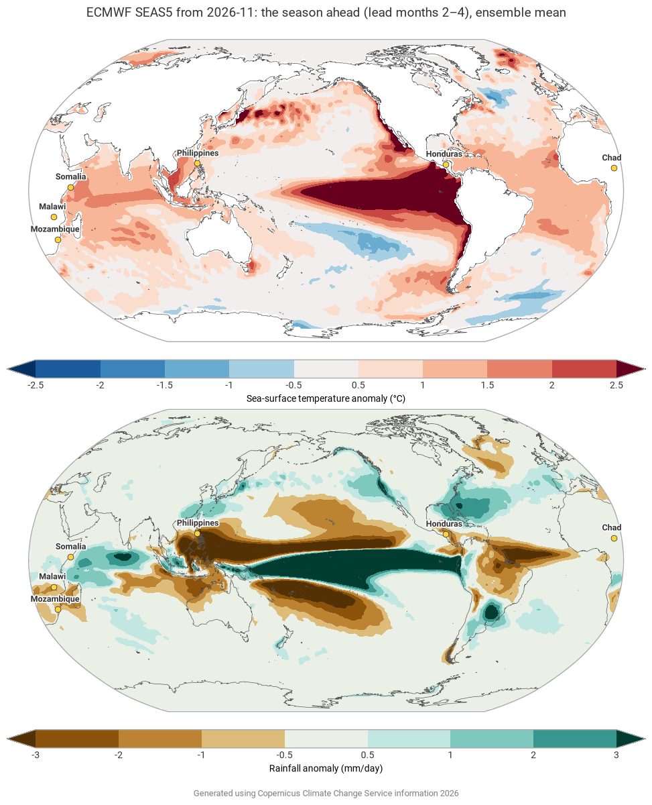
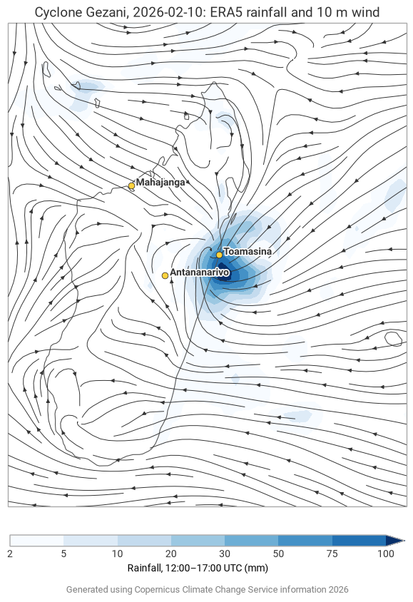
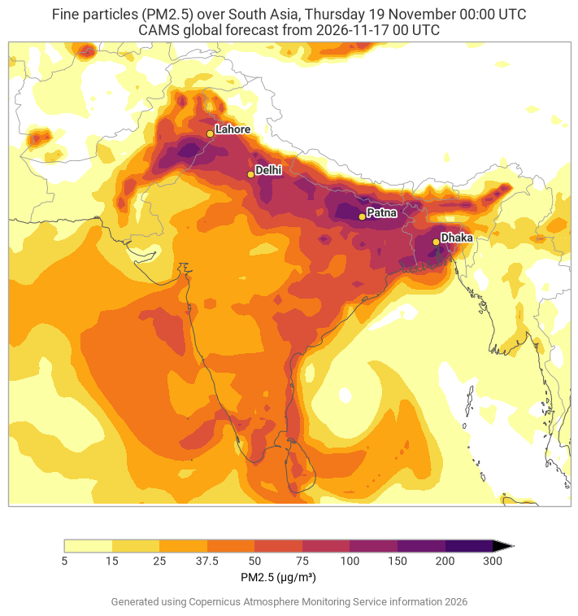
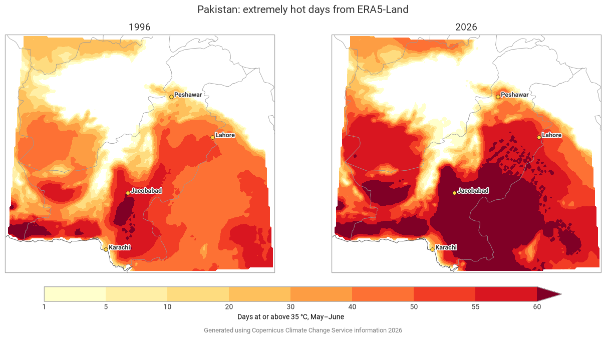

# Weather forecast maps — from ECMWF free & open data

Interactive notebooks for ECMWF Member State visits. **Scan the QR** (or click the Colab badge),
press **Runtime → Run all**, and make a live **9 km** forecast map for the country — then change
one line to make it for *your* country, day, or variable. Nothing to install.

Everything uses free, open data from ECMWF and open-source Python
([`ecmwf-opendata`](https://github.com/ecmwf/ecmwf-opendata),
[`earthkit`](https://earthkit-data.readthedocs.io), `h3`, `cartopy`).

---

## 🇧🇬 Bulgaria — rainfall

 

## 🇭🇺 Hungary — temperature

 

## 🇬🇷 Greece — the week ahead, every island

 

---

## UNICEF — ECMWF open data for the places UNICEF works

Two notebooks in [`unicef/`](unicef/), both from open data with no account. Each has a `PLACES` list of countries
where UNICEF responded to, or prepared for, weather and climate hazards in 2025–26 (Philippines, Somalia,
Mozambique, Malawi, Madagascar, Honduras, Chad, Pakistan).

**Where will the rain fall?** The next 10 days at 9 km.

 

**How sure are we?** The chance of heavy rain from two open ensembles, IFS ENS (physics) and AIFS ENS (machine learning).

 

### Copernicus data (free account and key)

Copernicus data, run by ECMWF for the EU, is free and open too; the data stores ask you to register once. Each
notebook asks for your key with a hidden prompt and keeps it only for the Colab session.

**El Niño in ECMWF's seasonal forecast** (C3S, SEAS5). UNICEF's October 2026 El Niño analysis used the September run.

 

**Look back at a cyclone with ERA5** (C3S reanalysis, 1940 to now). Cyclone Gezani, Madagascar, February 2026.

 

**The air children breathe, five days ahead** (CAMS). PM2.5 over South Asia; switch to Mongolia in one line.

 

**Counting hot days with ERA5-Land** (C3S). Days at or above 35 °C, the measure in UNICEF's Children's Climate Risk Report 2026.

 

---

## How it works

1. Request one field from ECMWF open data at 0.1° (~9 km) — `resol="0p1"`.
2. Read it with earthkit, bin every grid point into an **H3 hexagon** (res 5 ≈ 9 km), average per cell.
3. Keep the hexagons inside the country, draw the map, star the capital. (Greece keeps every hexagon that
   touches land, using the [geoBoundaries](https://www.geoboundaries.org) border, so the small islands stay.)

`tools/build_greece.py` builds and runs the Greece notebook; `tools/make_qr.py <notebook>` makes its QR.

## Data & licence

ECMWF Open Data is free under **Creative Commons CC-BY-4.0**
([Terms of Use](https://apps.ecmwf.int/datasets/licences/general/)):
`© ECMWF · Source: www.ecmwf.int · CC-BY-4.0 and ECMWF Terms of Use`.

Notebooks by Emma Pidduck · ECMWF User Services.
