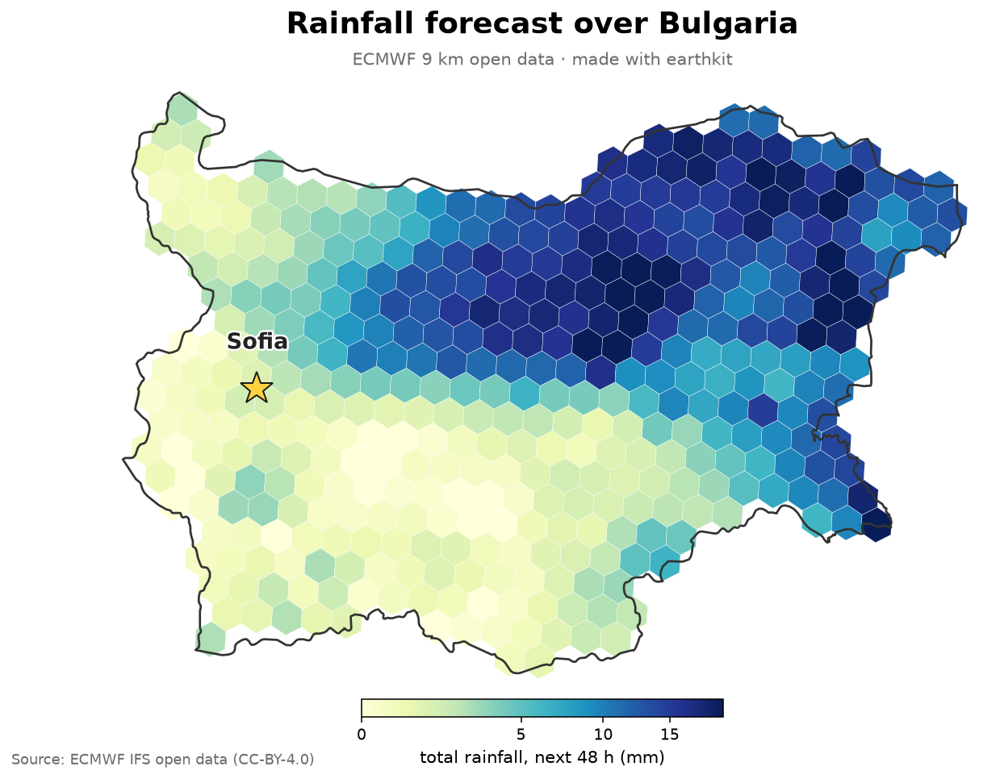
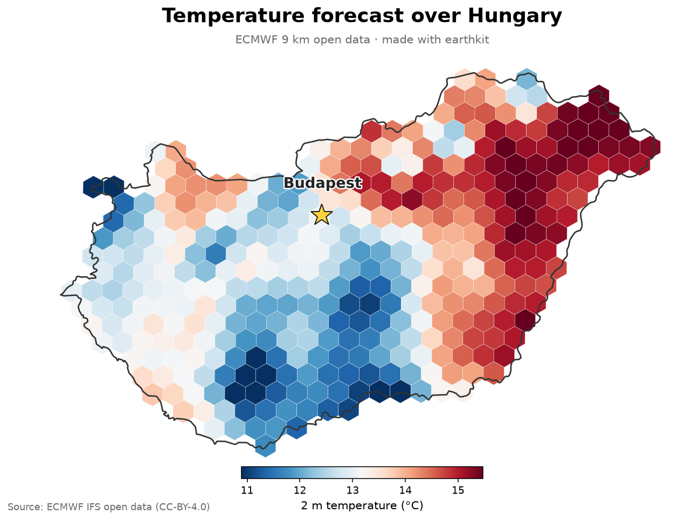

# Weather forecast maps — from ECMWF free & open data

Interactive notebooks for ECMWF Member State visits. **Scan the QR** (or click the Colab badge),
press **Runtime → Run all**, and make a live **9 km** forecast map for the country — then change
one line to make it for *your* country, day, or variable. Nothing to install.

Everything uses free, open data from ECMWF and open-source Python
([`ecmwf-opendata`](https://github.com/ecmwf/ecmwf-opendata),
[`earthkit`](https://earthkit-data.readthedocs.io), `h3`, `cartopy`).

---

## 🇧🇬 Bulgaria — rainfall

 

## 🇭🇺 Hungary — temperature

 

---

## How it works

1. Request one field from ECMWF open data at 0.1° (~9 km) — `resol="0p1"`.
2. Read it with earthkit, bin every grid point into an **H3 hexagon** (res 5 ≈ 9 km), average per cell.
3. Keep the hexagons inside the country, draw the map, star the capital.

## Data & licence

ECMWF Open Data is free under **Creative Commons CC-BY-4.0**
([Terms of Use](https://apps.ecmwf.int/datasets/licences/general/)):
`© ECMWF · Source: www.ecmwf.int · CC-BY-4.0 and ECMWF Terms of Use`.

Notebooks by Emma Pidduck · ECMWF User Services.
