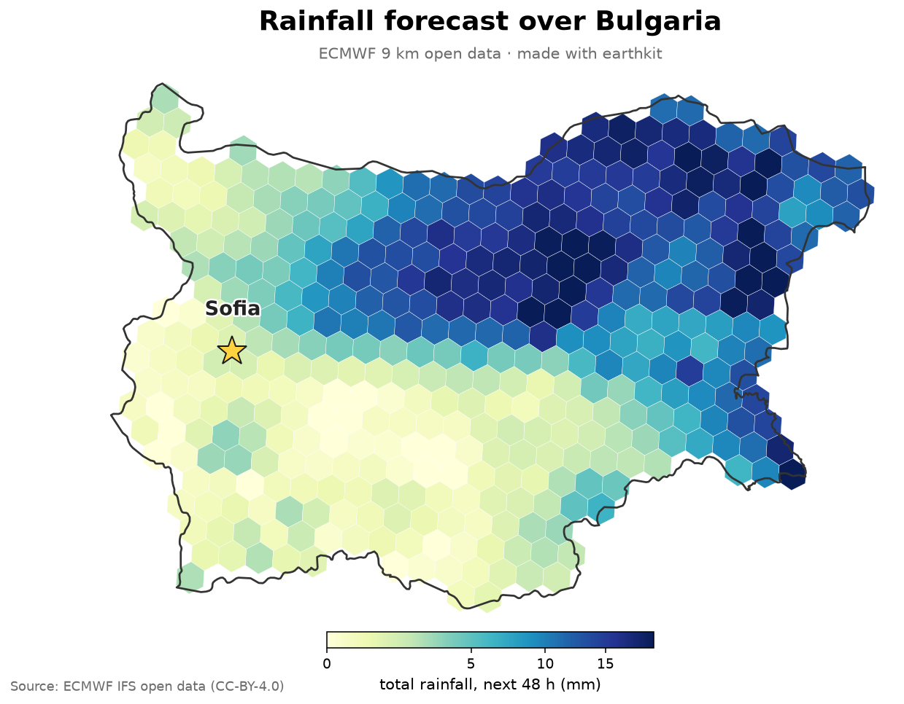

# 🇧🇬 Bulgaria: rainfall, the week ahead

Made for the ECMWF liaison visit to Bulgaria, 2026. Scan the QR (or click the badge), press **Runtime → Run all**, and make a
live **9 km** forecast map from ECMWF open data. Change one line to make it for your own country, day or variable.
No account, nothing to install.

 

ECMWF Open Data, CC BY 4.0: `© ECMWF · Source: www.ecmwf.int · CC-BY-4.0 and ECMWF Terms of Use`.
