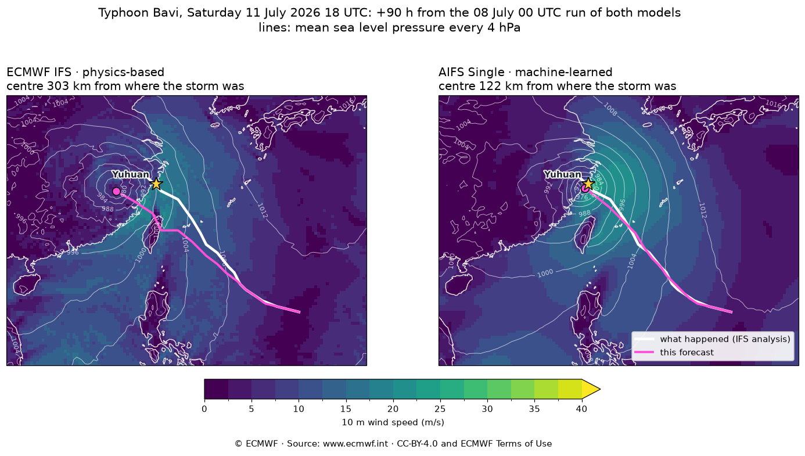
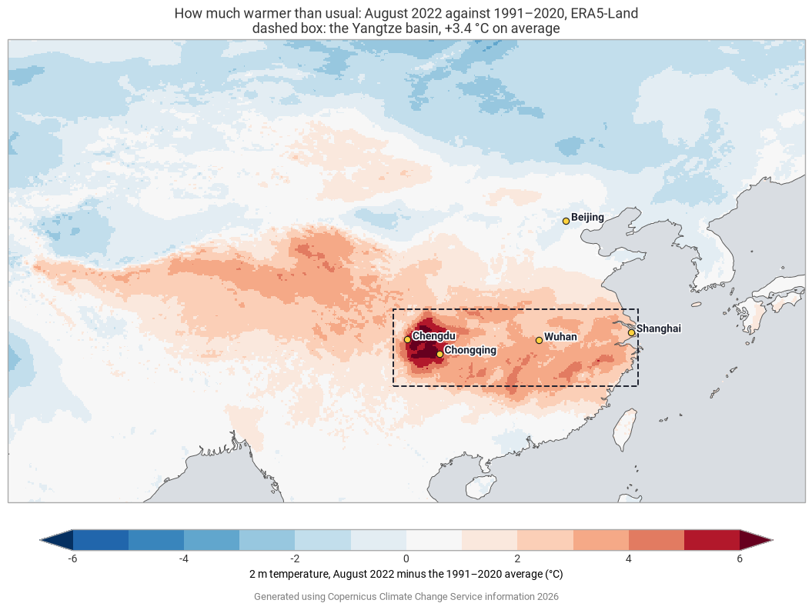

# 🇨🇳 China: weather and climate notebooks from ECMWF and Copernicus open data

Made for the ECMWF–China bilateral meeting, 2026. They go with the graphics in the visit talk: one notebook per story.
Every notebook runs in Google Colab: **scan the QR** (or click the badge) and press **Runtime → Run all**. Nothing to
install; everything runs on Google's computers, so a phone or a slow connection is fine. Each notebook ends with a
*Your turn* section, where one change makes it your own storm, month or day.

**This page:** scan the QR on the right to come back to the full list.

| | Notebook | Data | Account |
|---|---|---|---|
| 1 | [Typhoon Bavi in two ECMWF forecasts](#1-typhoon-bavi-in-two-ecmwf-forecasts) | ECMWF IFS and AIFS Single, 0.25° | none |
| 2 | [The Yangtze heatwave of August 2022](#2-the-yangtze-heatwave-of-august-2022) | ERA5-Land (C3S) | free Copernicus key |

 

---

## Forecasts: ECMWF open data, no account

### 1. Typhoon Bavi in two ECMWF forecasts

The physics-based IFS and the machine-learned AIFS Single from the same run, 8 July 2026 00 UTC, side by side when
Bavi came ashore at Yuhuan, Zhejiang (11 July, 18 UTC): 10 m wind, pressure, each model's track and the track the
storm took. One run shows one case, not which model is better.

 

---

## Looking back: Copernicus, free account and key

Copernicus data, produced by ECMWF for the European Union, is free and open too; the data stores ask you to register
once. Each notebook explains how, and asks for your key in a hidden box that is kept only for the Colab session.

### 2. The Yangtze heatwave of August 2022

How much warmer than usual August 2022 was, from ERA5-Land monthly means against the 1991–2020 average.

 

---

## Data & licence

- **ECMWF open data**, CC BY 4.0: `© ECMWF · Source: www.ecmwf.int · CC-BY-4.0 and ECMWF Terms of Use`.
- **Copernicus** (C3S, CAMS), Copernicus licence: *Generated using Copernicus Climate Change Service / Atmosphere
  Monitoring Service information 2026.*
- Coastlines: Natural Earth. The maps draw coastlines only.

These are worked examples, not official ECMWF products. Notebooks by Emma Pidduck · ECMWF User Services.
