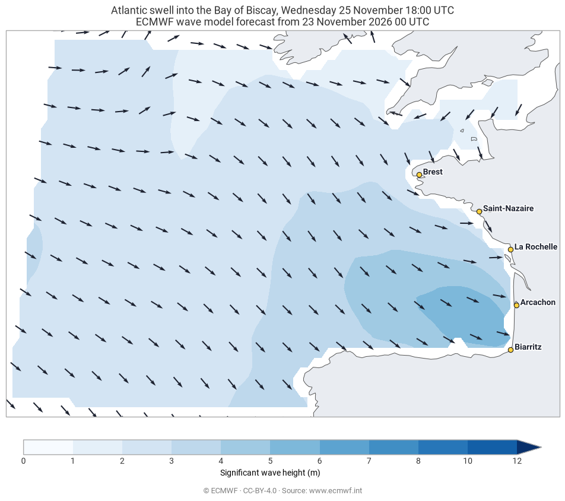
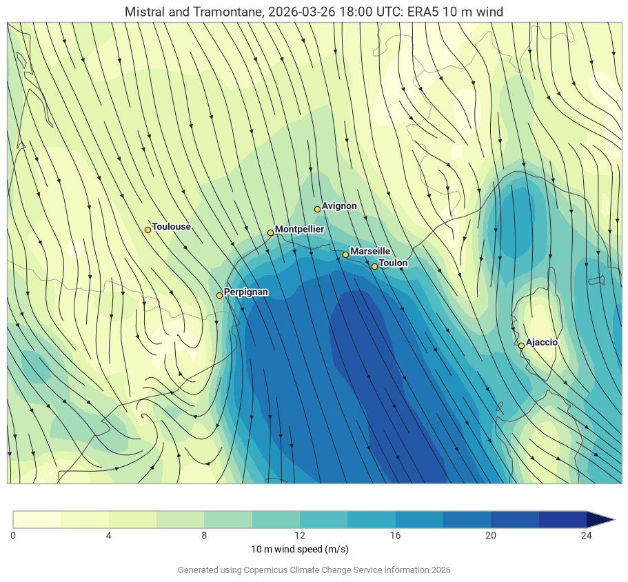
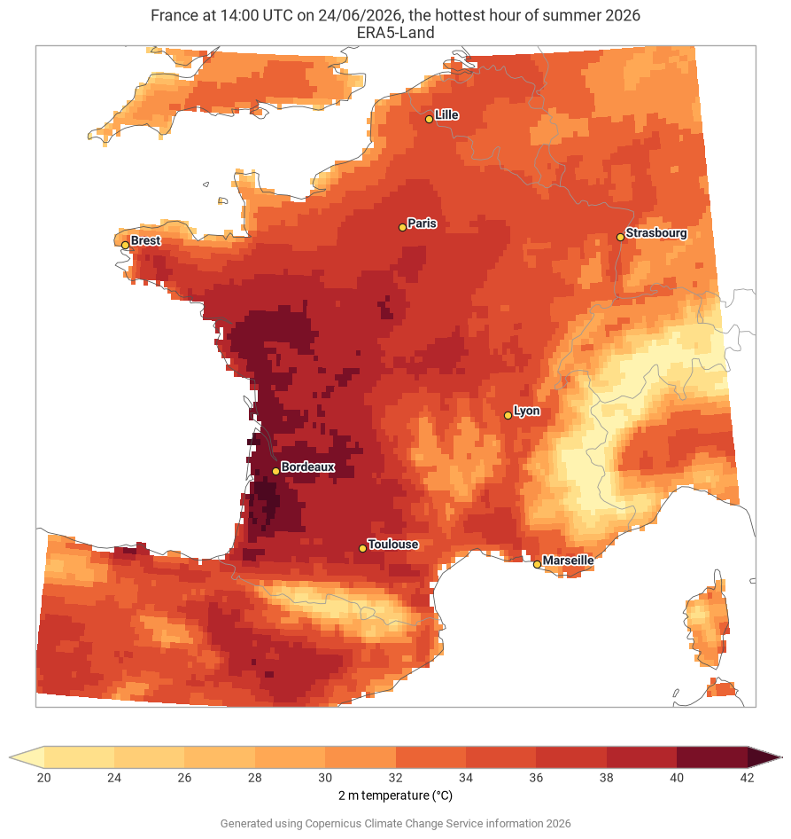

# 🇫🇷 France: weather and climate notebooks from ECMWF and Copernicus

Made for the ECMWF liaison visit to Météo-France, Toulouse, 2026. One notebook for each of the visit's three
animations: the same data, a single still map you can make yourself and change.
Every notebook runs in Google Colab: **scan the QR** (or click the badge) and press **Runtime → Run all**. Nothing to
install; everything runs on Google's computers, so a phone or a slow connection is fine. Each notebook ends with a
*Your turn* section, where one change makes it your own place, day or variable.

**This page:** scan the QR on the right to come back to the full list.

| | Notebook | Data | Account |
|---|---|---|---|
| 1 | [Atlantic swell into the Bay of Biscay](#1-atlantic-swell-into-the-bay-of-biscay) | ECMWF wave model | none |
| 2 | [Mistral and Tramontane over the Gulf of Lion](#2-mistral-and-tramontane-over-the-gulf-of-lion) | ERA5 (C3S) | free Copernicus key |
| 3 | [The hottest week of summer 2026](#3-the-hottest-week-of-summer-2026) | ERA5-Land (C3S) | free Copernicus key |

 

---

## Forecasts: ECMWF open data, no account

### 1. Atlantic swell into the Bay of Biscay

Significant wave height and peak period from ECMWF's wave model, the latest six-day forecast, at the moment
the biggest waves reach the French Atlantic coast.

 

---

## Looking back: Copernicus, free account and key

### 2. Mistral and Tramontane over the Gulf of Lion

26 March 2026, the windiest hour of the windiest three days of the past year, from ERA5.

 

### 3. The hottest week of summer 2026

21–27 June 2026: the hottest hour, Wednesday 24 June at 16:00, from ERA5-Land at about 9 km.

 

---

## Data & licence

- **ECMWF open data**, CC BY 4.0: `© ECMWF · Source: www.ecmwf.int · CC-BY-4.0 and ECMWF Terms of Use`.
- **Copernicus** (C3S), Copernicus licence: *Generated using Copernicus Climate Change Service information 2026.*

These are worked examples, not official ECMWF products. Notebooks by Emma Pidduck · ECMWF User Services.
