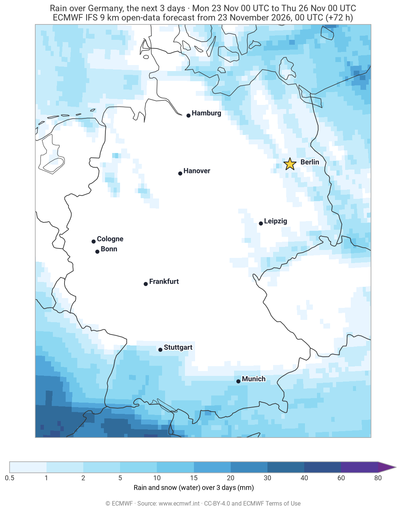

# 🇩🇪 Germany: a weather notebook from ECMWF open data

Made for the ECMWF liaison visit to Germany, 2026.
The notebook runs in Google Colab: **scan the QR** (or click the badge) and press **Runtime → Run all**. Nothing to
install; everything runs on Google's computers, so a phone or a slow connection is fine. It ends with a *Your turn*
section, where one change makes it your own place, day or variable.

| | Notebook | Data | Account |
|---|---|---|---|
| 1 | [Germany's weather, the next days, at 9 km](#1-germanys-weather-the-next-days-at-9-km) | ECMWF IFS 9 km | none |

---

### 1. Germany's weather, the next days, at 9 km

The newest ECMWF 9 km forecast: rain over the next three days, or, with
one line changed, temperature tomorrow afternoon, with the numbers for the big cities.

 

---

## Data & licence

- **ECMWF open data**, CC BY 4.0: `© ECMWF · Source: www.ecmwf.int · CC-BY-4.0 and ECMWF Terms of Use`.

This is a worked example, not an official ECMWF product. Notebooks by Emma Pidduck · ECMWF User Services.
