# 🇬🇷 Greece: weather and climate notebooks from ECMWF open data

Made for the ECMWF liaison visit to the Hellenic National Meteorological Service (HNMS), Athens, 23–24 November 2026.
Every notebook runs in Google Colab: **scan the QR** (or click the badge) and press **Runtime → Run all**. Nothing to
install; everything runs on Google's computers, so a phone or a slow connection is fine. Each notebook ends with a
*Your turn* section, where one change makes it your own place, day or variable.

**This page:** scan the QR on the right to come back to the full list.

| | Notebook | Data | Account |
|---|---|---|---|
| 1 | [The week ahead, every island](#1-the-week-ahead-every-island) | ECMWF IFS 9 km | none |
| 2 | [Waves around Greece, the next six days](#2-waves-around-greece-the-next-six-days) | ECMWF wave model | none |
| 3 | [Your stations, our forecast](#3-your-stations-our-forecast) | HNMS stations × ECMWF IFS 9 km and AIFS | none |
| 4 | [Beyond "how close": scoring a forecast](#4-beyond-how-close-scoring-a-forecast) | HNMS stations × ECMWF IFS, AIFS and both ensembles | none |
| 5 | [Two European forecasts, side by side](#5-two-european-forecasts-side-by-side) | ECMWF IFS 9 km × DWD ICON-EU | none |
| 6 | [The hottest week of summer 2026](#6-the-hottest-week-of-summer-2026) | ERA5-Land (C3S) | free Copernicus key |
| 7 | [The Meltemi over the Aegean](#7-the-meltemi-over-the-aegean) | ERA5 (C3S) | free Copernicus key |
| 8 | [How warm was the sea?](#8-how-warm-was-the-sea) | ERA5 (C3S) | free Copernicus key |
| 9 | [Saharan dust reaches Greece](#9-saharan-dust-reaches-greece) | CAMS | free Copernicus key |

 

---

## Forecasts: ECMWF open data, no account

### 1. The week ahead, every island

The latest 9 km forecast of afternoon temperature, binned into hexagons so that every island shows.

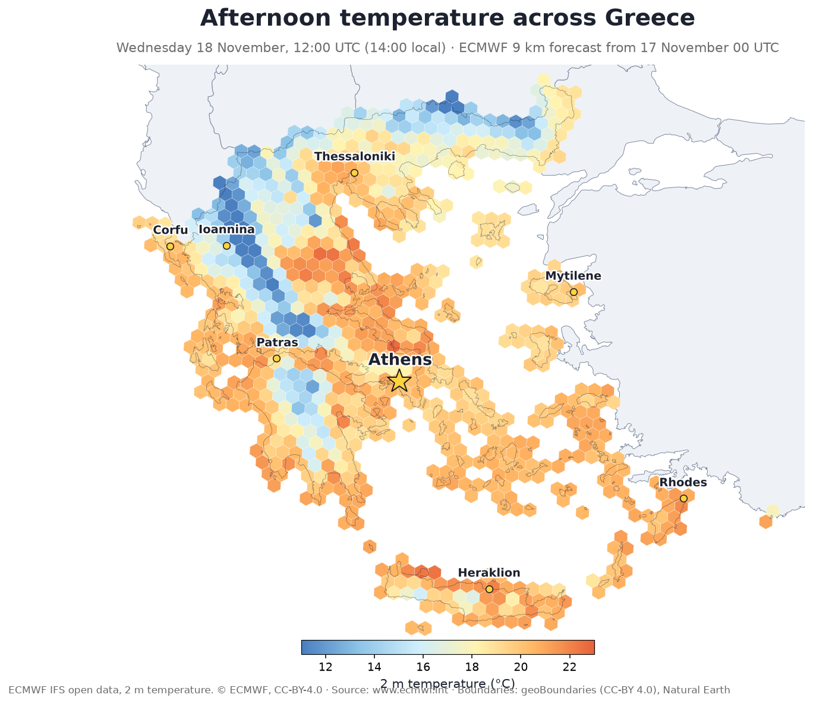

 

### 2. Waves around Greece, the next six days

Significant wave height from ECMWF's wave model, the latest six-day forecast.

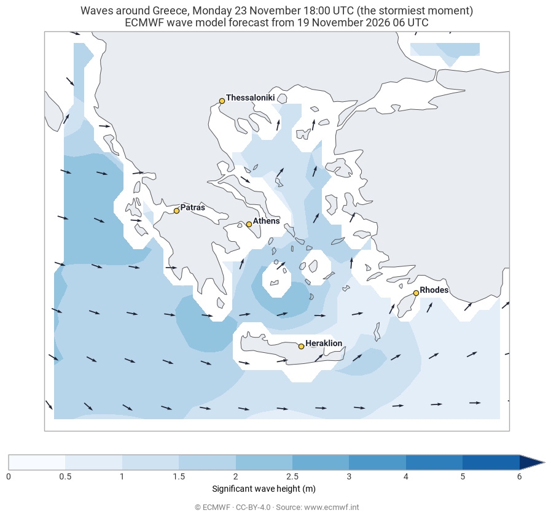

 

---

## Observations and other models: open data from three centres, no account

### 3. Your stations, our forecast

HNMS publishes its automatic weather stations as open data on [data.gov.gr](https://data.gov.gr) (every 5 minutes,
CC BY 4.0). This notebook fetches the last two days from every station and the ECMWF 9 km forecast for the same hours,
draws them on one map in one colour scale, and scores the forecast at each station, at the station's own height.
Then it does the same for **AIFS**, ECMWF's machine-learned forecast, and shows at which stations each model was
closer: the way to answer "IFS or AIFS?" for your own country is to verify both against your own stations, over many runs.

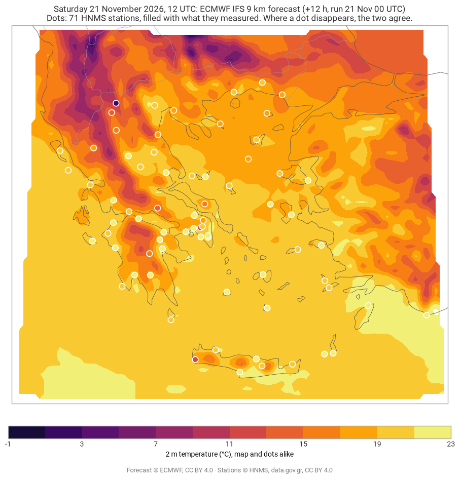
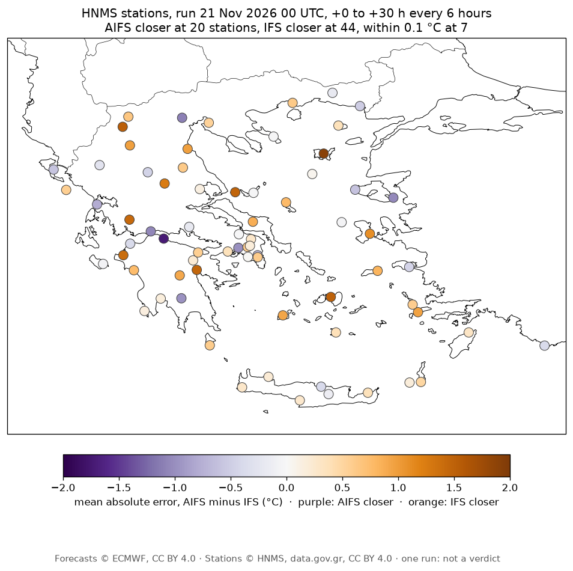

 

### 4. Beyond "how close": scoring a forecast

How close a forecast came is a start, but a crude one. This notebook works through the standard verification toolkit
on two days of HNMS stations: bias, RMSE and correlation, and the error taken apart (offset, variability, timing);
error growth with lead time and skill against "yesterday's weather"; errors by hour and by station type; hits, misses
and false alarms for rain and wind (POD, FAR, ETS); and the IFS and AIFS **ensembles** (CRPS, spread against error,
rank histogram). One setting runs it over weeks instead of days.

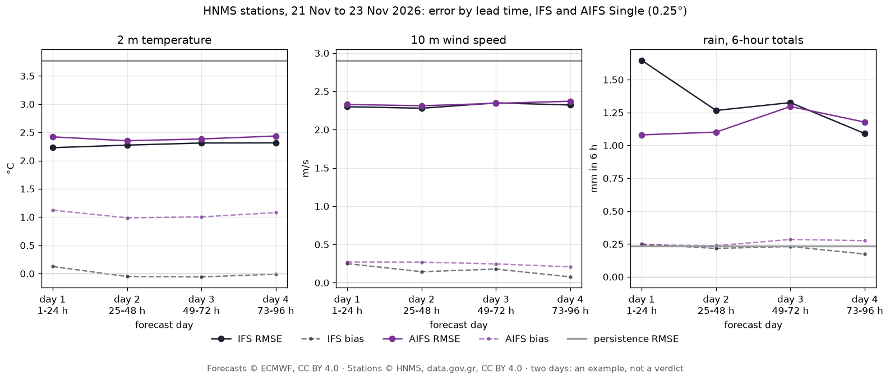
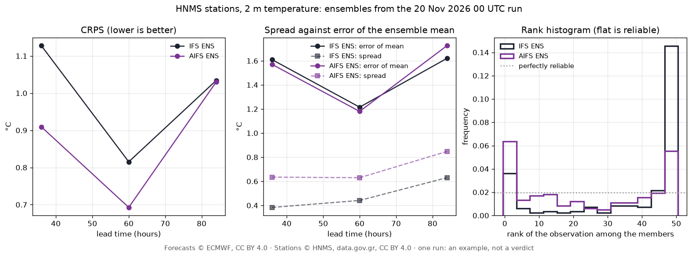

 

### 5. Two European forecasts, side by side

ECMWF's IFS (9 km) and Deutscher Wetterdienst's ICON-EU (6.5 km), both open data, from the newest run both have
published: 2 m temperature, 10 m wind or precipitation over Greece, the two forecasts and their difference, and both
models at one place for five days. It shows where two forecasts differ, not which one is right.

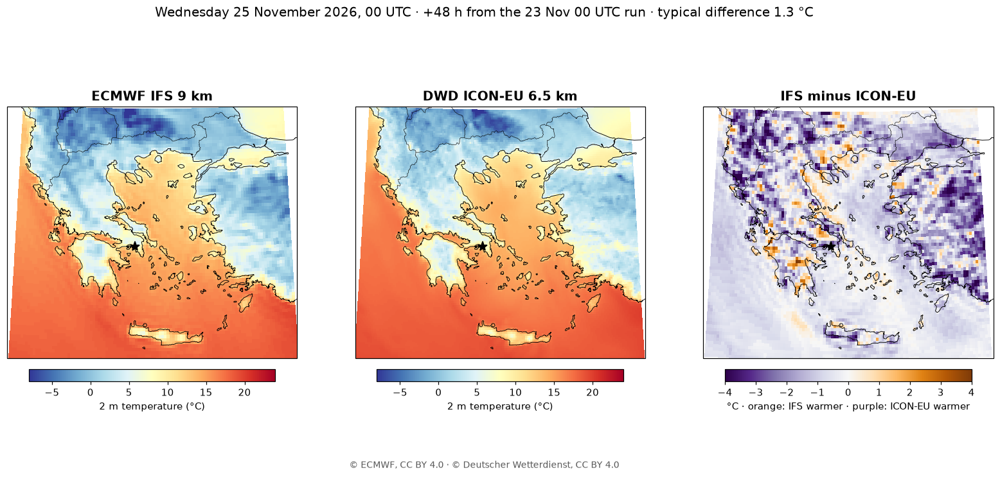

 

---

## Looking back: Copernicus, free account and key

Copernicus data, produced by ECMWF for the European Union, is free and open too; the data stores ask you to register
once. Each notebook explains how, and asks for your key in a hidden box that is kept only for the Colab session.

### 6. The hottest week of summer 2026

22–28 August 2026 hour by hour from ERA5-Land, the hottest hour mapped. Every island shows.

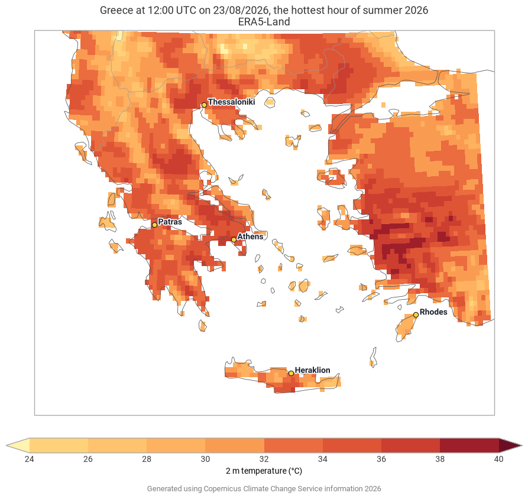

 

### 7. The Meltemi over the Aegean

The dry northerly summer wind down the Aegean, from ERA5.

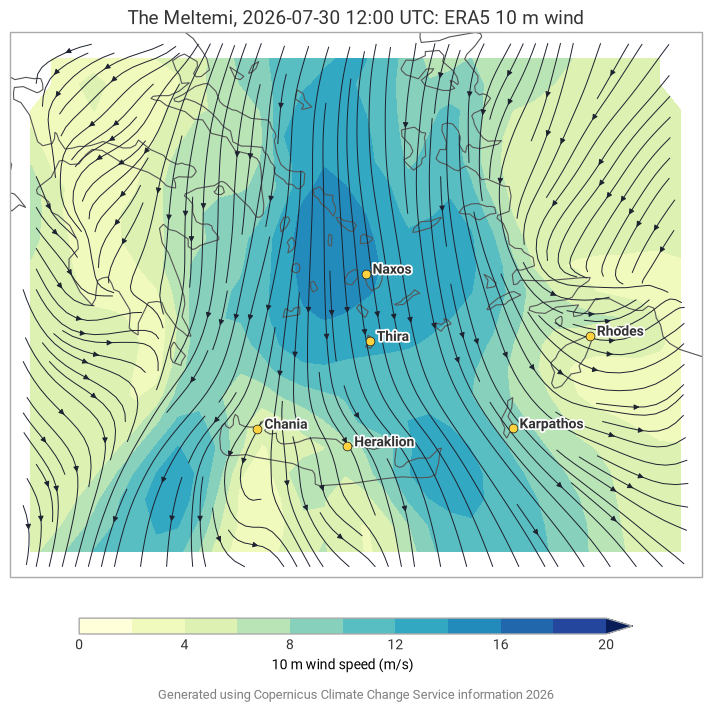

 

### 8. How warm was the sea?

The summer 2026 marine heatwave: sea surface temperature against the 1991–2020 average, from ERA5.

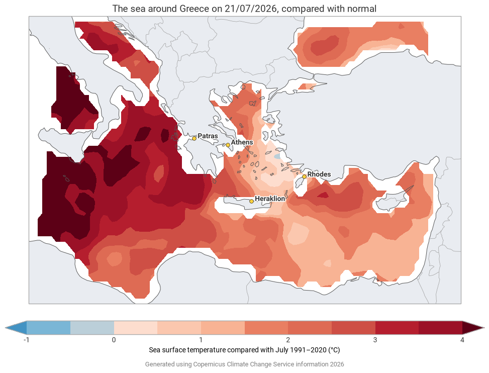

 

### 9. Saharan dust reaches Greece

11–15 November 2026: dust from Libya across the Ionian Sea to Greece, from the Copernicus Atmosphere Monitoring Service.

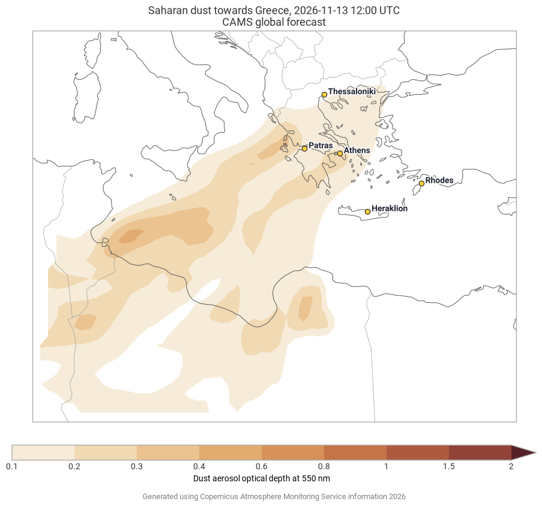

 

---

## Data & licence

- **ECMWF open data**, CC BY 4.0: `© ECMWF · Source: www.ecmwf.int · CC-BY-4.0 and ECMWF Terms of Use`.
- **HNMS station data**, CC BY 4.0: `© HNMS · Source: data.gov.gr`.
- **DWD open data**, CC BY 4.0: `Source: Deutscher Wetterdienst (opendata.dwd.de)`.
- **Copernicus** (C3S, CAMS), Copernicus licence: *Generated using Copernicus Climate Change Service / Atmosphere
  Monitoring Service information 2026.*

These are worked examples, not official ECMWF or HNMS products. Notebooks by Emma Pidduck · ECMWF User Services.
