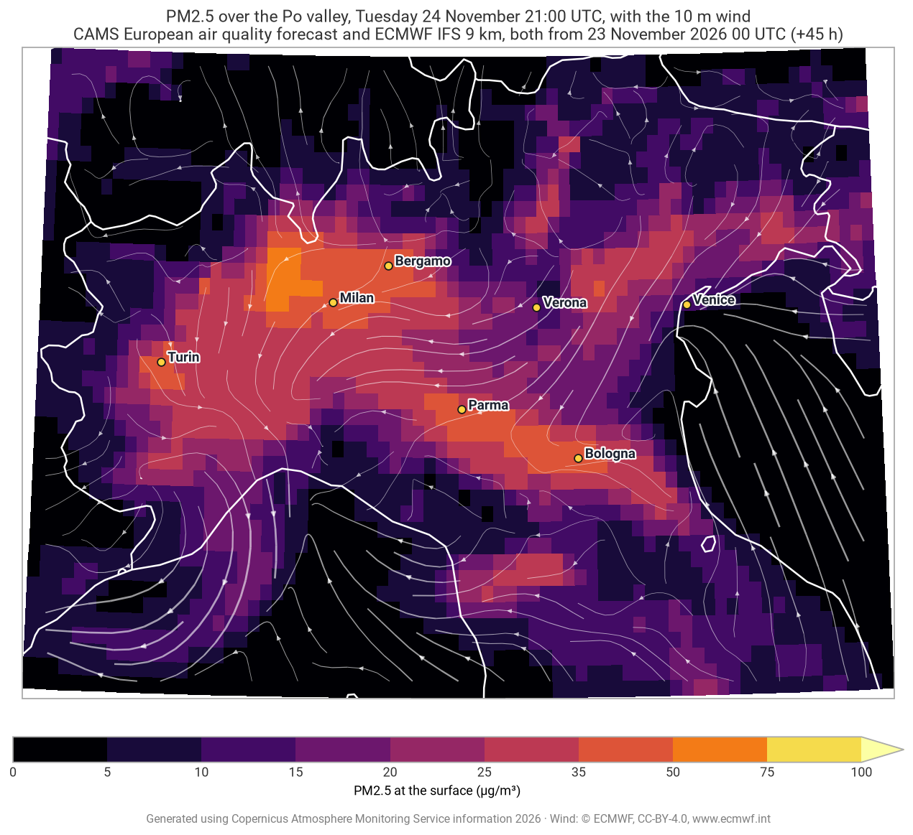

# 🇮🇹 Italy: a weather notebook from ECMWF open data

Made for the ECMWF liaison visit to Italy, 2026.
The notebook runs in Google Colab: **scan the QR** (or click the badge) and press **Runtime → Run all**. Nothing to
install; everything runs on Google's computers, so a phone or a slow connection is fine. It ends with a *Your turn*
section, where one change makes it your own place, day or variable.

| | Notebook | Data | Account |
|---|---|---|---|
| 1 | [Air quality in the Po valley, the next four days](#1-air-quality-in-the-po-valley-the-next-four-days) | CAMS European air quality × ECMWF IFS 9 km wind | free Copernicus key |

---

### 1. Air quality in the Po valley, the next four days

The Alps and the Apennines close the Po valley on three sides, and in winter fine particles build up on the
valley floor. The latest CAMS European air quality forecast (PM2.5, or NO₂ with a one-line switch), the most polluted
hour of the next four days, with the ECMWF 9 km 10 m wind at that hour. Copernicus data is free and open; the Atmosphere Data Store asks you to
register once. The notebook explains how, and asks for your key in a hidden box that is kept only for the Colab session.

 

---

## Data & licence

- **Copernicus** (CAMS), Copernicus licence: *Generated using Copernicus Atmosphere Monitoring Service information 2026.*
- **ECMWF open data**, CC BY 4.0: `© ECMWF · Source: www.ecmwf.int · CC-BY-4.0 and ECMWF Terms of Use`.

This is a worked example, not an official ECMWF product. Notebooks by Emma Pidduck · ECMWF User Services.
