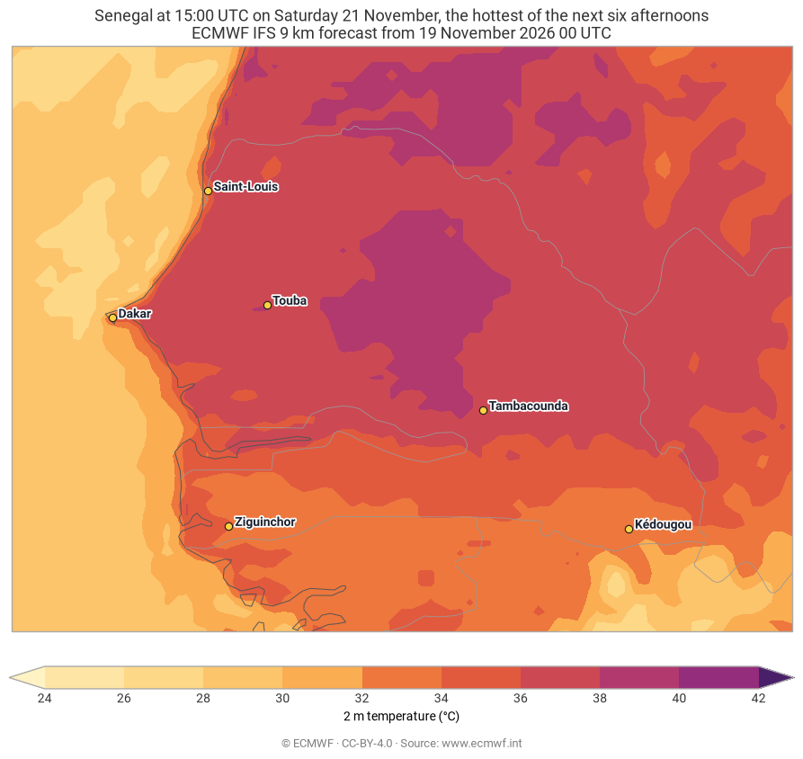
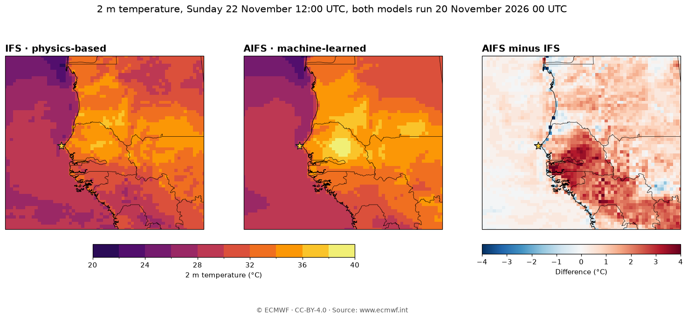
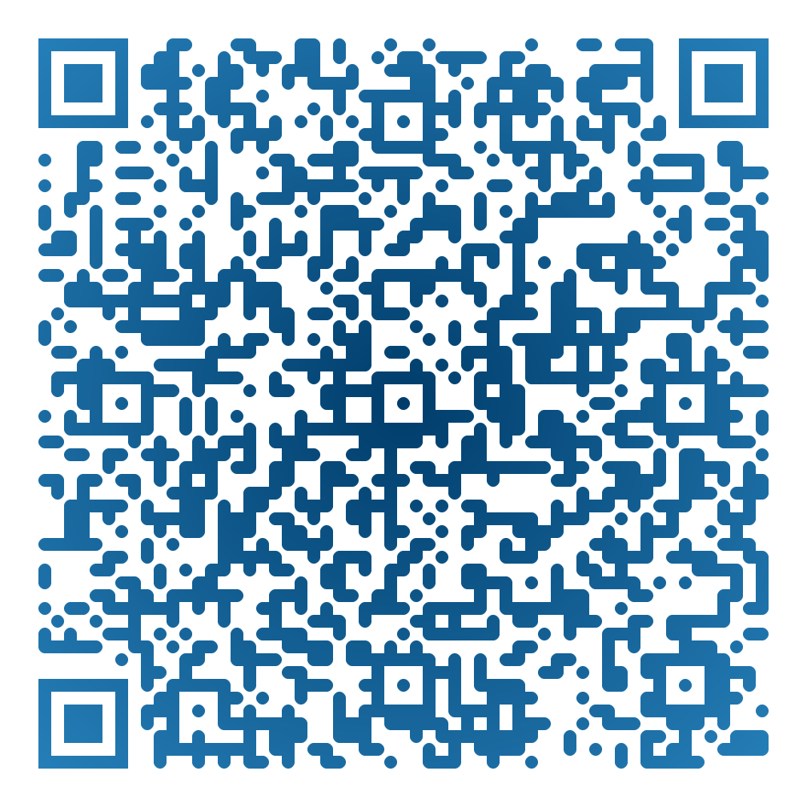
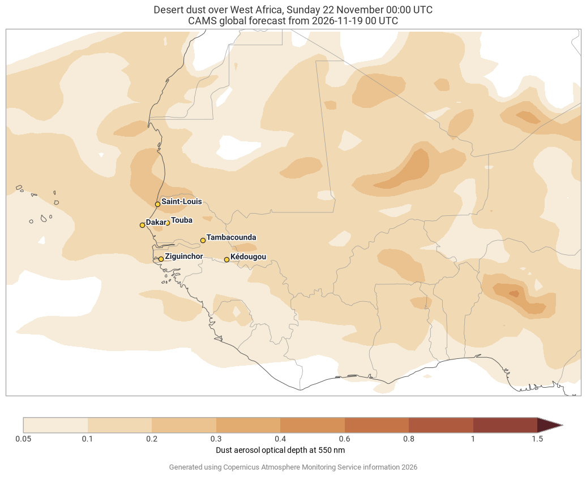
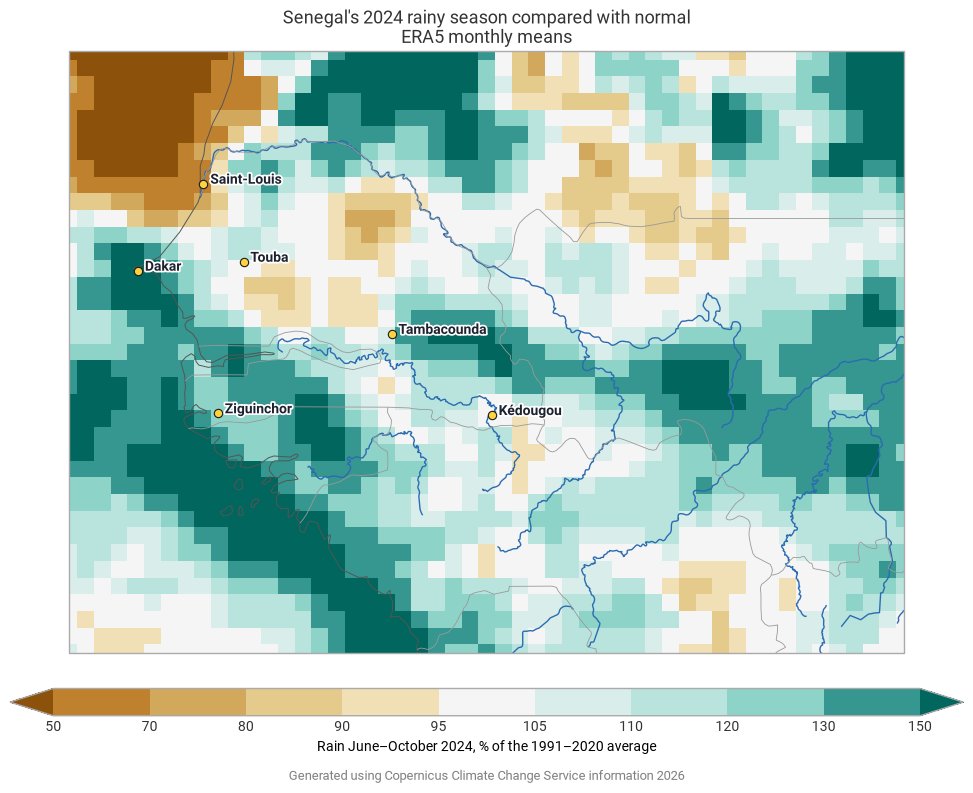

# 🇸🇳 Senegal — West Africa, for SEWA

Four notebooks in this folder for Strengthening Early Warnings for Africa (SEWA), part of the
Africa–EU Space Partnership Programme under the EU's Global Gateway: funded by the European Union, implemented by ECMWF.
Each comes in English, French (`_fr`) and Portuguese (`_pt`); the translations were made with AI assistance and checked
on a best-efforts basis, and the English version is the reference. The first two use open data with no account; the
forecast ones always fetch the latest run. Everything runs in Colab, so a slow or mobile connection is fine.

**The next six days at 9 km.** Afternoon 2 m temperature across Senegal and its neighbours (IFS open data).
 · [Version française](https://colab.research.google.com/github/piddy376/visits-weather-notebooks/blob/main/senegal/heat_forecast_fr.ipynb) · [Versão portuguesa](https://colab.research.google.com/github/piddy376/visits-weather-notebooks/blob/main/senegal/heat_forecast_pt.ipynb)

 

**AIFS and IFS, same run.** ECMWF's machine-learned and physics-based forecasts side by side, and the difference.
 · [Version française](https://colab.research.google.com/github/piddy376/visits-weather-notebooks/blob/main/senegal/aifs_vs_ifs_fr.ipynb) · [Versão portuguesa](https://colab.research.google.com/github/piddy376/visits-weather-notebooks/blob/main/senegal/aifs_vs_ifs_pt.ipynb)

 

### Copernicus data (free account and key)

**Desert dust, three days ahead** (CAMS). Dust aerosol optical depth over West Africa.
 · [Version française](https://colab.research.google.com/github/piddy376/visits-weather-notebooks/blob/main/senegal/dust_cams_fr.ipynb) · [Versão portuguesa](https://colab.research.google.com/github/piddy376/visits-weather-notebooks/blob/main/senegal/dust_cams_pt.ipynb)

 

**The 2024 rainy season with ERA5** (C3S). June–October rain as a percentage of the 1991–2020 normal; change `YEAR` for any year from 1940.
 · [Version française](https://colab.research.google.com/github/piddy376/visits-weather-notebooks/blob/main/senegal/rain_era5_fr.ipynb) · [Versão portuguesa](https://colab.research.google.com/github/piddy376/visits-weather-notebooks/blob/main/senegal/rain_era5_pt.ipynb)

 

---

## Data & licence

ECMWF Open Data is free under **Creative Commons CC-BY-4.0**
([Terms of Use](https://apps.ecmwf.int/datasets/licences/general/)):
`© ECMWF · Source: www.ecmwf.int · CC-BY-4.0 and ECMWF Terms of Use`.

Copernicus data (C3S, CAMS), produced by ECMWF for the European Union, is free and open under the Copernicus licence:
*Generated using Copernicus Climate Change Service / Atmosphere Monitoring Service information 2026.*

Notebooks by Emma Pidduck · ECMWF User Services.
