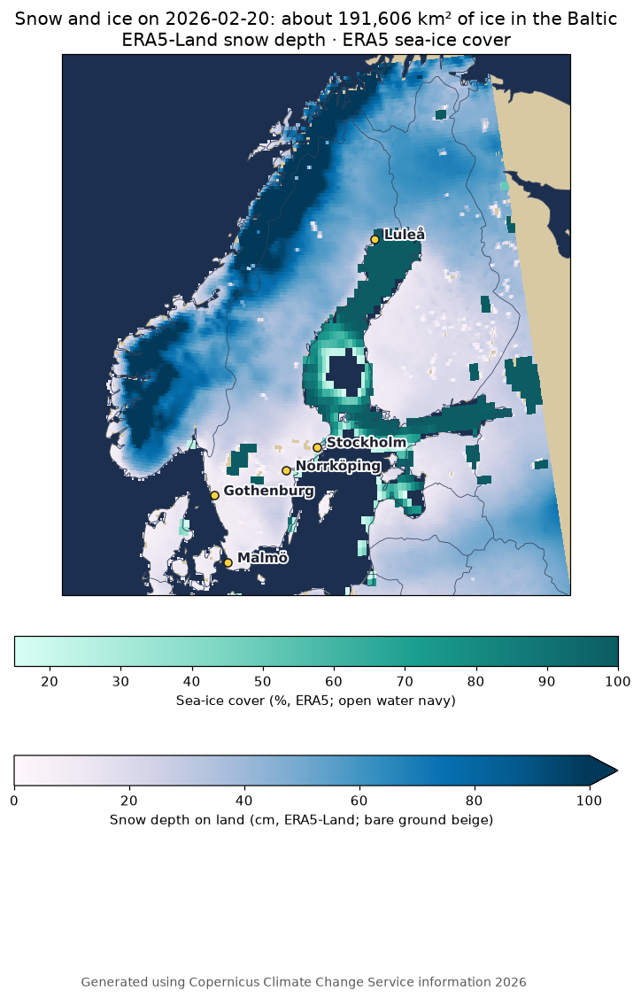
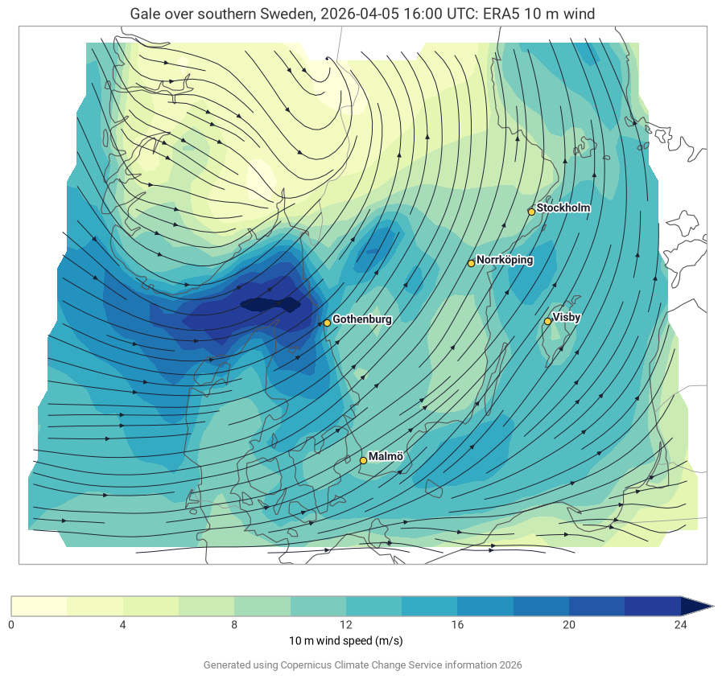
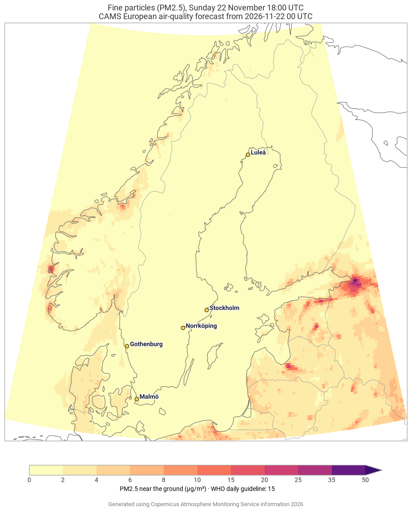

# 🇸🇪 Sweden: weather and climate notebooks from ECMWF and Copernicus

Made for the ECMWF liaison visit to SMHI, Norrköping, 2026. One notebook for each of the visit's three
animations: the same data, a single still map you can make yourself and change.
Every notebook runs in Google Colab: **scan the QR** (or click the badge) and press **Runtime → Run all**. Nothing to
install; everything runs on Google's computers, so a phone or a slow connection is fine. Each notebook ends with a
*Your turn* section, where one change makes it your own place, day or variable.

**This page:** scan the QR on the right to come back to the full list.

| | Notebook | Data | Account |
|---|---|---|---|
| 1 | [A Swedish winter](#1-a-swedish-winter) | ERA5-Land and ERA5 (C3S) | free Copernicus key |
| 2 | [The windiest three days of the past year](#2-the-windiest-three-days-of-the-past-year) | ERA5 (C3S) | free Copernicus key |
| 3 | [Air quality now](#3-air-quality-now) | CAMS | free Copernicus key |

 

---

## Looking back: Copernicus reanalyses, free account and key

### 1. A Swedish winter

20 February 2026, the day of the largest Baltic ice extent: snow depth from ERA5-Land, sea ice from ERA5.

 

### 2. The windiest three days of the past year

4–6 April 2026: the westerly gale of Sunday 5 April through the Skagerrak, from ERA5.

 

---

## Now: Copernicus forecast, free account and key

### 3. Air quality now

Fine particles (PM2.5) over Sweden from the latest CAMS European air-quality forecast, four days ahead.

 

---

## Data & licence

- **Copernicus** (C3S, CAMS), Copernicus licence: *Generated using Copernicus Climate Change Service / Atmosphere
  Monitoring Service information 2026.*

These are worked examples, not official ECMWF products. Notebooks by Emma Pidduck · ECMWF User Services.
