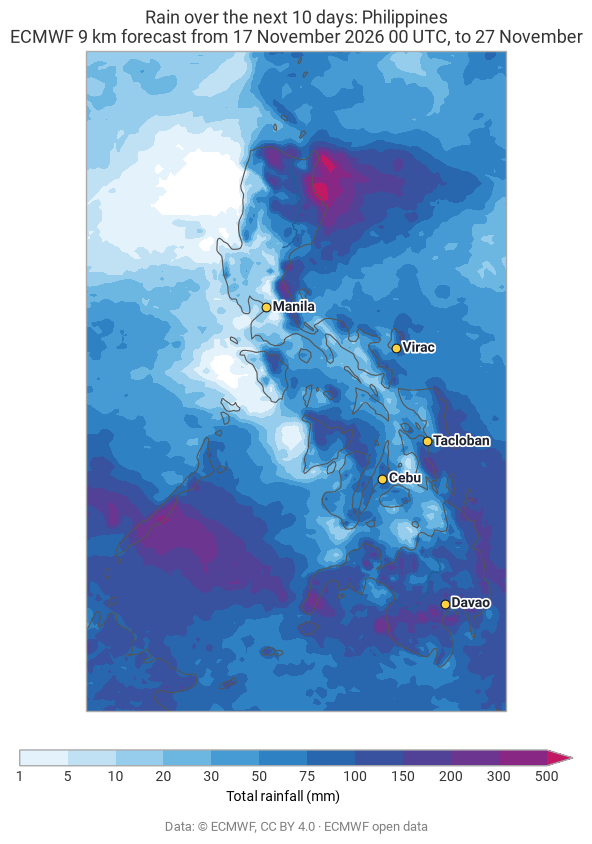
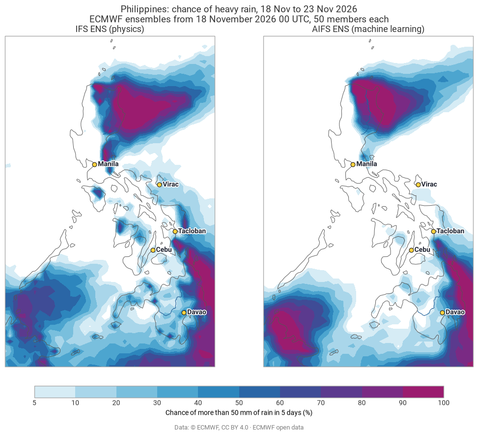
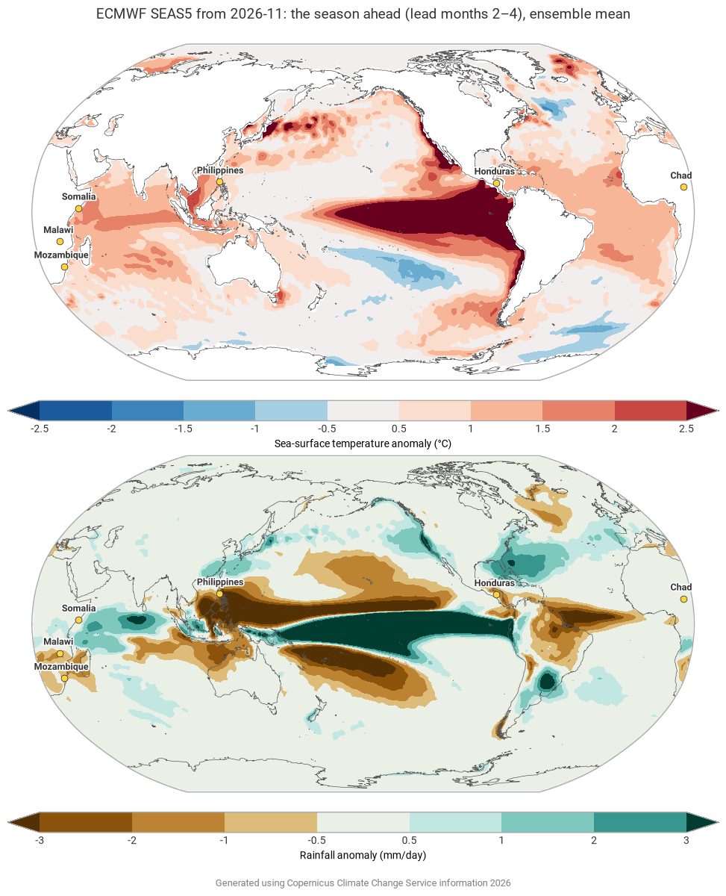
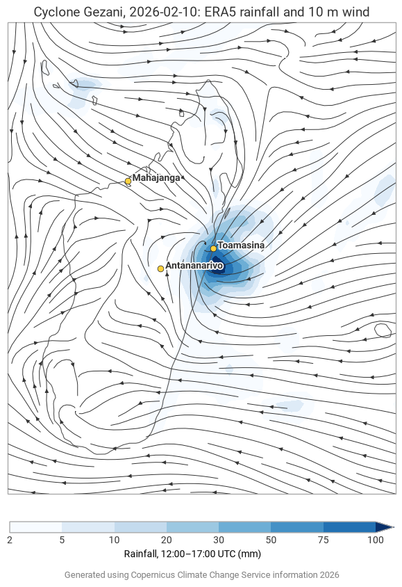
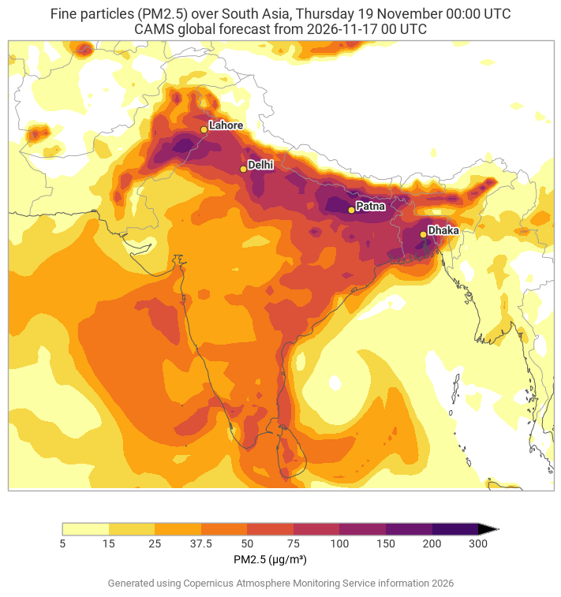
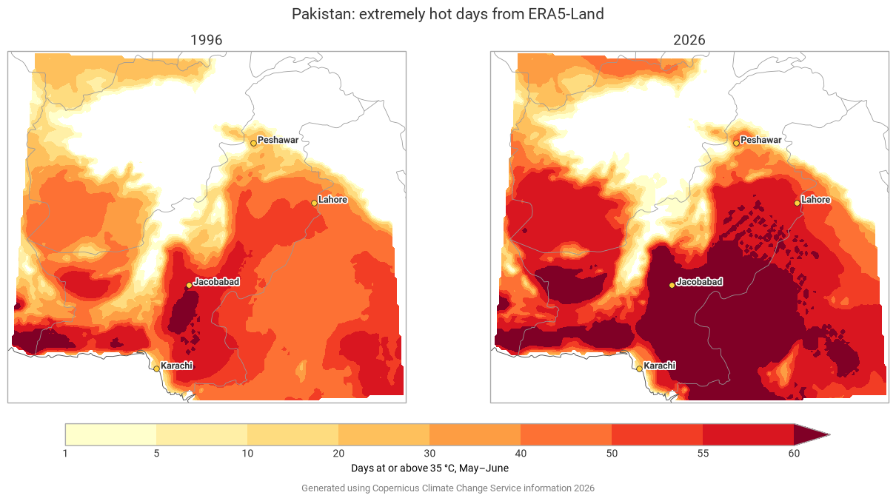

# UNICEF — ECMWF open data for the places UNICEF works

Six notebooks: two from ECMWF open data with no account, four from Copernicus with a free key. The open-data ones have a `PLACES` list of countries
where UNICEF responded to, or prepared for, weather and climate hazards in 2025–26 (Philippines, Somalia,
Mozambique, Malawi, Madagascar, Honduras, Chad, Pakistan).

**Where will the rain fall?** The next 10 days at 9 km.

 

**How sure are we?** The chance of heavy rain from two open ensembles, IFS ENS (physics) and AIFS ENS (machine learning).

 

### Copernicus data (free account and key)

Copernicus data, run by ECMWF for the EU, is free and open too; the data stores ask you to register once. Each
notebook asks for your key with a hidden prompt and keeps it only for the Colab session.

**El Niño in ECMWF's seasonal forecast** (C3S, SEAS5). UNICEF's October 2026 El Niño analysis used the September run.

 

**Look back at a cyclone with ERA5** (C3S reanalysis, 1940 to now). Cyclone Gezani, Madagascar, February 2026.

 

**The air children breathe, five days ahead** (CAMS). PM2.5 over South Asia; switch to Mongolia in one line.

 

**Counting hot days with ERA5-Land** (C3S). Days at or above 35 °C, the measure in UNICEF's Children's Climate Risk Report 2026.

 

---

## Data & licence

ECMWF Open Data is free under **Creative Commons CC-BY-4.0**
([Terms of Use](https://apps.ecmwf.int/datasets/licences/general/)):
`© ECMWF · Source: www.ecmwf.int · CC-BY-4.0 and ECMWF Terms of Use`.

Copernicus data (C3S, CAMS), produced by ECMWF for the European Union, is free and open under the Copernicus licence:
*Generated using Copernicus Climate Change Service / Atmosphere Monitoring Service information 2026.*

Notebooks by Emma Pidduck · ECMWF User Services.
